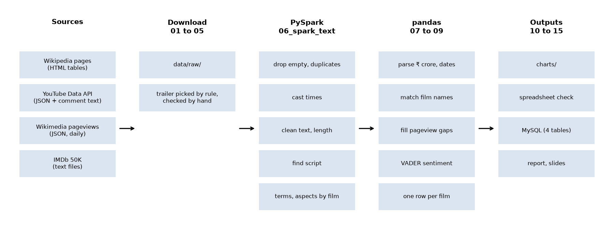
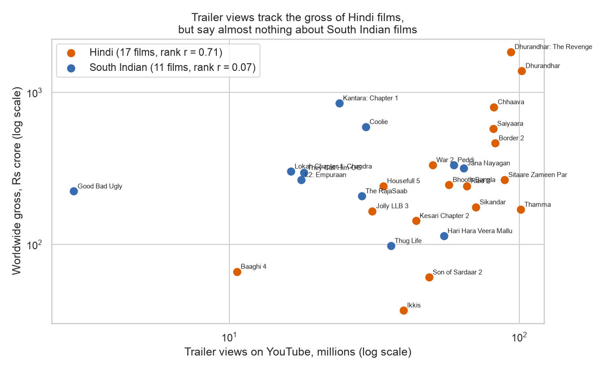
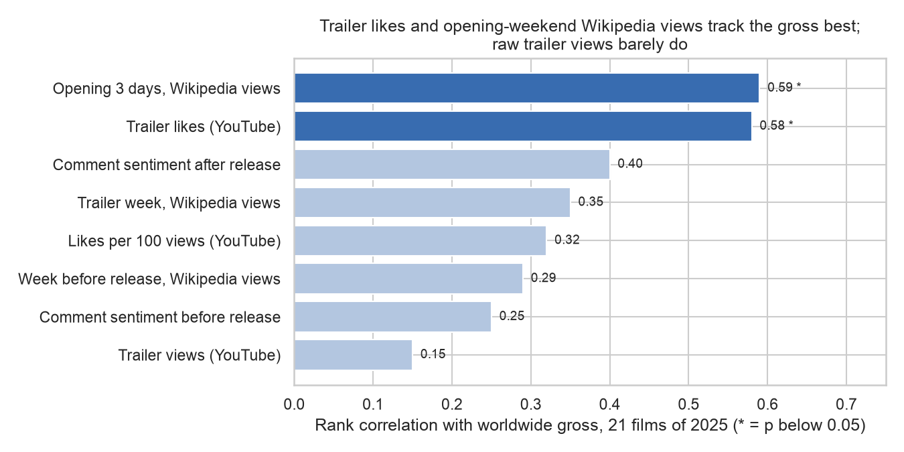
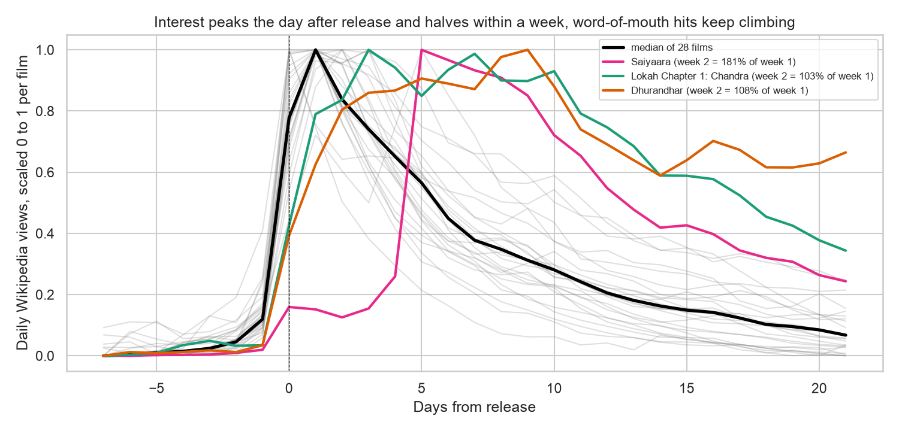
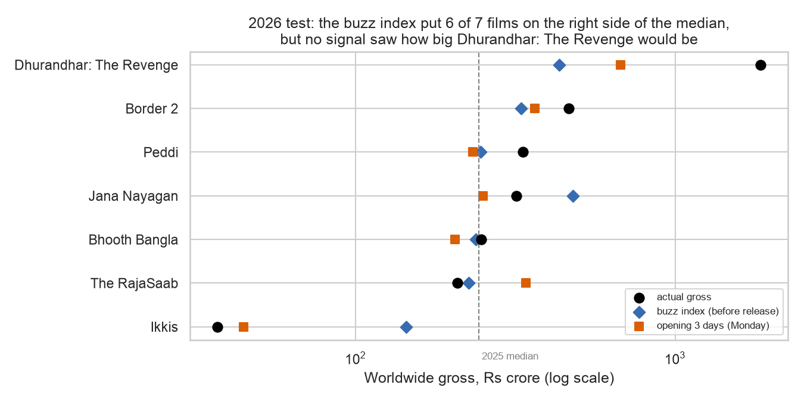
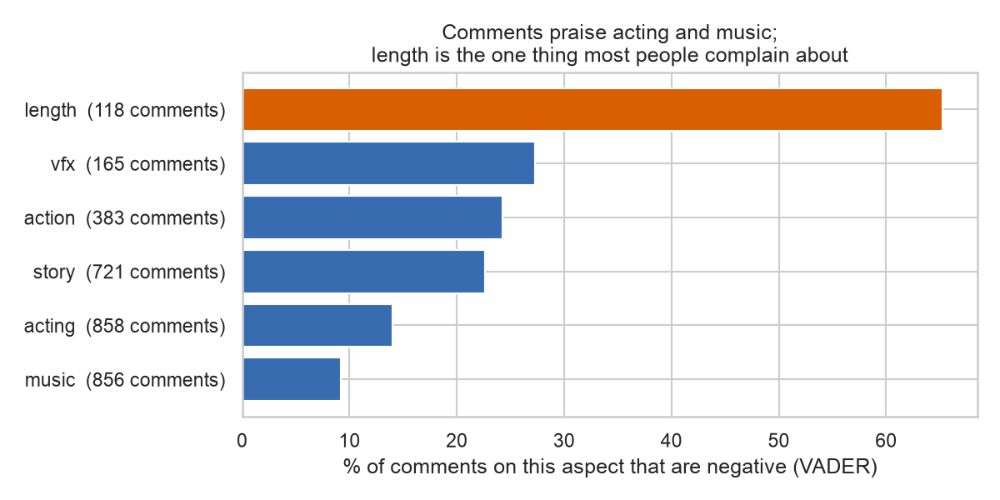
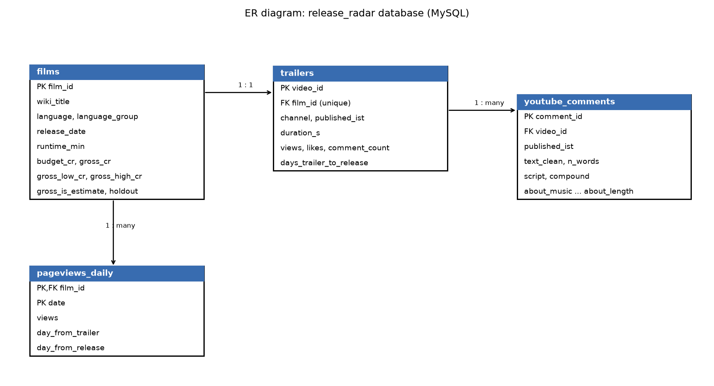

# Release Day Radar

**Case Study A, Data and Storytelling, Module 1**

**Rahul Patnaik (1RV23CD041), Vishal P Joy (1RV23CD059), Ansh Ravi Kashyap (1RV23CS040), Pratyush RB (1RV23CS181)**

**November 2026**

## a. Executive summary

Trailer views on their own told us almost nothing about how much a film would earn (rank correlation 0.15 across 21 films of 2025). The two signals that did track worldwide gross were trailer likes and Wikipedia views in the first three days after release (0.58 and 0.59), and how well interest held up in week two separated hits from flops. We recommend that the Head of Distribution stops planning screens from trailer view counts, checks opening-weekend Wikipedia views on Monday morning to add or cut screens, and puts extra promotion only behind films whose interest is still holding in week two.

## b. The question and why it matters

We asked: **did the online buzz around a film's trailer and release predict how much it grossed, across 28 Hindi and South Indian films released in 2025 and 2026?**

Every Monday after a Friday release the Head of Distribution has to decide whether to add screens, cut screens or spend more on promotion. Today that call rests on the Friday collection, a few trade tweets and gut feel. Online buzz arrives much faster than box-office figures, so if any of it lines up with the final gross, the desk can act on it within 72 hours.

We picked 28 theatrical films by a rule: released between January 2025 and July 2026 (so every run has ended and the gross is final), Hindi plus all four South Indian languages, and a deliberate mix of hits and flops. By gross-to-budget ratio there are 6 hits (2x budget or more), 8 average films and 11 flops; 3 films have no usable budget. The 21 films of 2025 were used to find patterns and build a buzz index. The 7 films of 2026 were kept aside and only used at the end, to test whether the index would have called films it had never seen.

We measure success as **worldwide gross**, not opening weekend. Wikipedia reports opening weekends in sentences that mix net and gross, India and worldwide, and 3-day and 4-day weekends, and some pages give no figure at all. Worldwide gross sits in the same table field on every page.

## c. Data inventory and V profile

### Sources

The full source register, with URLs and terms of use, is in Appendix A.

| Source | What it gives us | Format | Size |
|---|---|---|---|
| Wikipedia film pages and box-office lists | Release date, language, runtime, budget, worldwide gross | HTML tables (infobox and ranking tables) | 28 film pages, 3 list pages, 294 ranking rows |
| YouTube Data API v3 | Trailer views, likes, comment count, upload time; top comments | JSON, plus free text | 28 trailers, 32,522 comments |
| Wikimedia Pageviews API | Daily English Wikipedia views of each film's page | JSON | 4,439 title-days, 1,924 film-days |
| IMDb 50K movie reviews (Maas et al., Stanford) | 50,000 English reviews labelled positive or negative | Text files | 50,000 reviews |

### Data types

| Field | Source | Type | Structure |
|---|---|---|---|
| film_id, wiki_title, language, language_group | Wikipedia, our key | Nominal | Structured (HTML table) |
| release_date, trailer upload time | Wikipedia, YouTube | Continuous (time) | Structured / semi-structured |
| release weekday | Worked out | Ordinal (Mon to Sun) | Structured |
| runtime_min, budget_cr, gross_cr | Wikipedia | Continuous | Structured (stored as text, cast) |
| gross_is_estimate, holdout | Wikipedia "est.", our label | Nominal (yes or no) | Structured |
| verdict (hit, average, flop) | Worked out from gross / budget | Ordinal | Structured |
| views, likes, comment count | YouTube | Discrete | Semi-structured (nested JSON, numbers as text) |
| daily pageviews, day_from_release | Wikimedia, worked out | Discrete | Semi-structured (JSON) |
| comment text | YouTube | Text | Unstructured |
| comment likes | YouTube | Discrete | Semi-structured |
| script (Latin, Devanagari, Tamil ...) | Worked out in PySpark | Nominal | Structured |
| about_music, about_story ... | Worked out in PySpark | Nominal (yes or no) | Structured |
| sentiment (VADER compound, -1 to +1) | Worked out | Continuous | Structured |
| IMDb review text / label / stars | IMDb corpus | Text / nominal / ordinal | Unstructured / structured |

The verdict and the star rating are ordinal: "hit" is clearly better than "flop" and 9 stars better than 7, but the steps between them are not equal, so we rank them and never average them.

### V profile

**Volume.** The 28 trailers have 1.43 billion views and 990,737 comments between them. Downloading every comment would have taken two days of the free YouTube quota, so we took the top comments (about 1,000 to 1,270 per trailer, 32,522 in all, 4 MB). Wikipedia gave 1,924 film-days and 100.9 million page views. The IMDb corpus is 84 MB zipped and 64 MB as one table. The PySpark text job ran over 82,522 rows.

**Velocity.** Buzz rises and fades within days. For 16 of the 28 films Wikipedia interest peaked the day after release, and by the second week it had dropped to a median 43% of the first. The busiest day was 786,957 views for Dhurandhar: The Revenge, about 32,800 an hour. A single trailer collects tens of thousands of comments (Jana Nayagan has 111,832), most of them in its first days.

**Variety.** This V dominated. We joined HTML tables, nested JSON from two APIs and free text in six scripts (85% Latin, the rest Devanagari, Telugu, Malayalam, Tamil and Kannada, plus emoji-only comments). The same film appeared as "Raid 2 (film)", "RAID 2 (TRAILER): Ajay D | ..." and "Raid 2" in a ranking table, and money came as text like "₹1,350.83–₹1,428 crore". Variety is why we built one cleaned key (`film_id`) and a money parser first. PySpark was used for the text because it is the largest and messiest table. To be honest, 82,522 rows would fit in pandas, but the same Spark job would run unchanged on all 990,737 comments.

## d. Pipeline from source to chart

Rows left after each step of the PySpark job:

| Step | Rows |
|---|---|
| 1. Raw rows: YouTube comments + IMDb reviews | 82,522 (32,522 + 50,000) |
| 2. Empty text dropped | 82,520 |
| 3. Duplicate ids dropped | 82,520 |
| 4. YouTube times that would not parse | 0 |
| 7. Clean rows (length, script and aspect columns added) | 82,520 |
| 8. Distinct film and term pairs | 62,443 |
| 10. Film summary rows | 28 |

1. `01_get_wikipedia.py` downloads each film's page and three box-office list pages, and reads the infobox and ranking tables.
2. `02_find_trailers.py` searches YouTube once per film and picks the trailer by a rule; we then checked every pick by hand (`data/trailers.csv`).
3. `03_get_youtube.py` gets trailer statistics and the top comments, without usernames, and flattens the JSON with `pd.json_normalize`.
4. `04_get_pageviews.py` gets daily Wikipedia views for every title a film's page has had.
5. `05_get_imdb.py` reads the IMDb 50K archive into one table.
6. `06_spark_text.py` is the PySpark job: clean, measure length, detect script, count terms and aspect words, aggregate by film.
7. `07_clean.py` casts money, dates and counts, matches film names and fills pageview gaps.
8. `08_sentiment.py` tests VADER on IMDb, fixes it for Indian film slang and scores our comments.
9. `09_metrics.py` and `10_analysis.py` build one row per film, the buzz index and every chart.
10. `11_pivot_check.py` repeats one cleaning step in Excel. `12_load_mysql.py` loads MySQL and runs the queries.

## e. Cleaning log

| # | Problem found | Rows affected | Action | Why |
|---|---|---|---|---|
| 1 | The same film is named differently in every source ("L2: Empuraan", "L2E Empuraan Trailer (Malayalam)") | 28 films, 3 sources | Gave every film one key (`film_id`). Built a matching key: lower case, drop footnotes, "(2025 film)", trailer words and punctuation. 27 of 28 matched exactly; Empuraan matched on similarity 0.95 and was checked by eye | Without one key nothing joins. Checking the one fuzzy match stops a wrong join |
| 2 | YouTube search returns the wrong trailer: Netflix's post-release OTT trailer for Chhaava, Hindi dubs of South Indian films, one fan reaction video | 7 of 28 trailers | Rule: uploaded before release, title says "trailer" not teaser or reaction, no OTT or cinema channels. Then a hand check; 7 picks replaced by the original-language official upload | Every film must be measured the same way: its own official trailer in its own language |
| 3 | Money stored as text: "₹797.34–809 crore", "est. ₹242.8 crore", "₹1,350.83–₹1,428 crore", three different dash characters | 28 grosses, 27 budgets | Parsed to numbers in crore. A range becomes its midpoint; 12 grosses were ranges and 12 were marked "est.", both kept as flags | Arithmetic needs numbers. The midpoint is fair to both ends, and the flags let us see which figures are softer |
| 4 | Budgets we cannot use | Dhurandhar and Dhurandhar: The Revenge share one budget; Kantara: Chapter 1 has none | Set to missing; gross-to-budget only for the other 25 films | Splitting a shared budget would be a guess |
| 5 | Two Wikipedia tables disagree on the gross | 1 of 18 films found in both (OG: ₹293–300 crore vs ₹155 crore) | Kept the infobox figure for all films | The film's own page carries the sources for its number; 17 of 18 agreed |
| 6 | Dates and times in mixed text forms: "14 February 2025 (2025-02-14)", YouTube times in UTC | All films and comments | Took the ISO date in brackets; converted YouTube UTC times to IST before splitting by day | Release days are Indian days. A trailer posted at 11 PM IST is a UTC date one day earlier |
| 7 | Numbers stored as text: viewCount "81719599", duration "PT2M41S" | 28 trailers | Cast to integers and seconds | Counts must be numbers to compare |

| # | Problem found | Rows affected | Action | Why |
|---|---|---|---|---|
| 8 | Wikipedia pages get renamed; the views API counts each title separately | 21 of 28 films, up to 8 titles (Dhurandhar: The Revenge, from "Draft:Dhurandhar 2" onwards) | Found old titles in the page's edit history and added up the views of every title | Reading only today's title would lose 6.9% of all views, and every one of Saiyaara's 1,012,504 release-week views |
| 9 | Days with no pageview record | 28 of 1,924 film-days, all before the page was created | Filled with 0 | Nobody can read a page that does not exist yet |
| 10 | Usernames in comments | All comments | Never downloaded: the API `fields` filter asks only for text, time and likes | The brief asks us to protect people; we had no use for names |
| 11 | Empty or repeated comments | 2 empty, 0 duplicate ids | Dropped | Nothing to analyse |
| 12 | Comments not in Latin script | 4,787 of 32,522 (15%), 2,341 of them emoji or numbers only | Kept for counts, left out of sentiment | VADER only reads English; a Tamil comment would score a meaningless 0 |
| 13 | VADER reads 🔥 as the word "fire", which it rates negative | 3,643 comments (11.2%) contain 🔥 | Added four domain words: fire and goosebumps +2, cringe -2, 💥 neutral. Mean score of 🔥 comments moved from -0.28 to +0.72; accuracy on IMDb stayed 69.7% | In trailer comments 🔥 is praise. Unfixed, the most hyped trailers would look the most disliked |
| 14 | Films of very different scale (trailer views 35x apart, gross 50x apart) | All films | Log scale and rank correlation for comparisons; z-scores for the buzz index; min-max scaling for the interest curves | One giant film would otherwise drown out every other film |
| 15 | Far more comments than we could download (990,737; two days of free quota) | 958,215 not downloaded | Took the top comments by YouTube's relevance order, about 1,000 to 1,270 per trailer | The top comments are the ones most people read. Limitation: we cannot say exactly when the trailer-week comments came in |

## f. Findings

### 1. Trailer views track Hindi films, not South Indian ones

This chart joins two sources on `film_id`: YouTube for the views and Wikipedia for the gross. Over all 28 films, Hindi trailer views lined up with the gross (rank r = 0.71, 17 films), while South Indian films did not at all (0.07, 11 films). South Indian films earned a median ₹151 for every trailer view against ₹53 for Hindi films. Good Bad Ugly grossed ₹224 crore from a Tamil trailer with only 2.9 million views; Thamma had 101 million views and grossed ₹170 crore. One likely reason is that South Indian audiences watch trailers in several dubbed versions and fan uploads, so one official upload undercounts them.

### 2. Likes and opening-weekend Wikipedia views beat raw trailer views

Across the 21 films of 2025, trailer views had a rank correlation of only 0.15 with gross (p = 0.52, no better than chance). Trailer likes reached 0.58 and Wikipedia views in the first three days after release 0.59, both with p = 0.006. A view can be bought through ads or autoplay; a like takes a decision, and a Wikipedia visit means someone wants to know more about the film.

### 3. Interest peaks the day after release and halves within a week, unless word of mouth is strong

Each film is scaled so that its own busiest day is 1, so big and small films share one picture. The typical film peaks on day 1 and is below 40% of its peak by day 7. Saiyaara, Lokah and Dhurandhar kept climbing for a week or more; their week-2 interest was 181%, 103% and 108% of week 1. Across all 28 films, those whose interest held up best were the ones that beat our buzz-based forecast (rank r = 0.51, p = 0.006), and so were those with warmer comments after release (r = 0.45, p = 0.02). All six films whose week-2 interest fell to 37% of week 1 or less were flops: Hari Hara Veera Mallu, Thug Life, The RajaSaab, Baaghi 4, Jana Nayagan and Sikandar. We set the 37% line after seeing these numbers, so it is a rule of thumb found on the same 28 films, not a tested forecast: War 2 held 39% and was also a flop, L2: Empuraan held 39% and was not, and the rule catches 6 of the 11 flops (Good Bad Ugly, at 41%, slipped through). The one exception at the other end is Ikkis, which held 68% but from a tiny base (45,000 views in its opening three days, the lowest of all 28) and still flopped, so the hold only means something for a film that drew real interest in the first place.

### 4. Tested on 2026: a fair guide, not a crystal ball

We built a buzz index from three trailer-stage signals (trailer views, trailer likes and Wikipedia views in trailer week, each as a z-score of its log, then averaged) and fitted it on the 2025 films only. On the 7 films of 2026 it put 6 on the right side of the 2025 median gross (₹243 crore) and was typically 1.4 times off. Opening-weekend Wikipedia views were typically 1.3 times off. Neither saw the size of Dhurandhar: The Revenge, which grossed ₹1,852 crore against forecasts of ₹434 crore and ₹676 crore; a sequel to a huge hit is something the buzz numbers do not capture.

### 5. Comments praise acting and music, and complain about length

The PySpark job tagged each comment by the part of the film it mentions. Music and acting are the most talked about and the most positive (9% and 14% negative). Only length stands out: 65% of the 118 comments about length, pace or boredom are negative.

## g. Recommendation for next Friday

1. **Before release, stop judging a film by its trailer view count.** Look at trailer likes instead, and do not compare South Indian trailers with Hindi ones on views at all.
2. **On Monday morning, check opening-weekend Wikipedia views** (Friday to Sunday, free and public, ready on Monday). Compare them with the 21 films in our table. A film well above its trailer-based forecast is a candidate for more screens.
3. **On the second Friday, check whether interest is holding.** If week-2 Wikipedia views have fallen to about 37% of week 1 or less, cut screens and do not add promotion money; all six such films in our set were flops. Treat 37% as a rule of thumb found on these 28 films: just above it, War 2 held 39% and was also a flop, while L2: Empuraan held 39% and made 1.6 times its budget. If they are above about 60% and the film opened with real interest, keep or add screens and spend promotion behind the word of mouth.

The desk can run this as three numbers on one page each Monday: trailer likes, opening-weekend views against forecast, and week-2 hold.

## h. Limitations and bias

* **Small sample.** 28 films, 7 in the test. One unusual film (Dhurandhar: The Revenge) can move the results, and a correlation of 0.6 still leaves much unexplained.
* **Correlation, not cause.** Likes and Wikipedia views go with a big gross; they do not cause it. Star power, release date, screens and competition all play a part, and we had no screen counts.
* **Who is online.** English Wikipedia readers and YouTube commenters are younger, urban and English-reading. Audiences in small towns and in regional languages are under-counted, which may be part of why South Indian films look different.
* **One trailer per film.** We used the official original-language upload only. Dubbed versions and fan uploads are left out, which undercounts pan-India films most.
* **Paid promotion and bots.** Trailer views can be pushed by ads, and fan clubs mass-like and mass-comment. We did not try to measure this, which may be one reason raw views predict so poorly.
* **Sentiment tool.** VADER is right 70% of the time on IMDb, and it catches praise (86%) far better than criticism (53%). It cannot read Hinglish well, nor the 15% of comments in other scripts.
* **Top comments, not all comments.** YouTube decides the relevance order. We cannot say how fast comments arrived after the trailer.
* **Box-office figures** come from Wikipedia, which quotes trade sites. 12 grosses are estimates and 12 are ranges.

## i. Reflection

Our first question was whether trailer views predict the opening weekend. Opening weekends turned out to be reported inconsistently on Wikipedia, so we switched to worldwide gross. We also began by downloading every comment on every trailer, close to a million, until we saw it needed two days of API quota and was not needed to answer the question; the top comments were enough. Our biggest surprise was that raw views, the number everyone quotes, was the weakest signal we tested. The sentiment step taught us to check our tools: the first scores said the most hyped trailers were the most disliked, until we found that VADER reads 🔥 as fire.

With better data we would want daily box-office and screen counts from trade sources, BookMyShow ticket sales, YouTube views by day (only the film's owner can see them), and a sentiment model that reads Hindi, Tamil and Telugu.

## Appendix A. Source register

| Source | URL | Accessed | Method | Terms of use |
|---|---|---|---|---|
| Wikipedia film pages and list pages | https://en.wikipedia.org/w/api.php (action=parse) | 21 Nov 2026 | Python requests, named User-Agent, pauses and retries | CC BY-SA 4.0 |
| YouTube Data API v3 | https://www.googleapis.com/youtube/v3/ (search, videos, commentThreads) | 21 Nov 2026 | Free API key; a full run uses about 3,200 of the 10,000 free daily units (28 searches at 100 units, the rest 1 unit per call) | YouTube API Services Terms; no usernames stored |
| Wikimedia Pageviews API | https://wikimedia.org/api/rest_v1/metrics/pageviews/ | 21 Nov 2026 | Python requests, user traffic only | CC0 |
| IMDb Large Movie Review Dataset | https://ai.stanford.edu/~amaas/data/sentiment/ | 21 Nov 2026 | One archive download | Free for research, cite Maas et al. (2011) |

## Appendix B. Spreadsheet vs pandas

The cleaning step we repeated is turning Wikipedia's gross text into a number in crore. In the spreadsheet (`data/clean/gross_cleaning_spreadsheet.xlsx`) column C strips "₹", commas, "est." and "crore" with nested `SUBSTITUTE`s, columns D and E split a range at the dash with `FIND`, `LEFT`, `MID` and `VALUE`, and column F takes the midpoint. Microsoft Excel calculated it. In pandas the same step is the `parse_money()` function in `07_clean.py`, a few regular expressions.

The two agreed on all 28 films; the largest difference was 0.0000000000001 crore, which is floating-point rounding. The spreadsheet lets a non-programmer see every step cell by cell, but it only works because we first made all three dash characters the same. The pandas version also handles lakh, billion and plain rupee amounts, and reruns in a second when the data changes.

## Appendix C. MySQL schema and queries

The database `release_radar` has four tables linked by keys: `films`, `trailers` (one per film), `pageviews_daily` (one per film per day) and `youtube_comments` (many per trailer). The schema is in `sql/schema.sql`, the queries in `sql/queries.sql` and their output in `sql/query_results.txt`.

| Query | What it does | SQL used |
|---|---|---|
| Q1 | Rows in each table | UNION ALL |
| Q2 | Trailer views and likes next to gross | JOIN |
| Q3 | Hindi vs South Indian: gross per trailer view | JOIN, GROUP BY |
| Q4 | Opening 3 days of Wikipedia views vs trailer views vs gross | 3-table JOIN, GROUP BY |
| Q5 | Comment sentiment before and after release, per film | 3-table JOIN, GROUP BY, CASE |
| Q6 | Comments and sentiment by aspect (music, story ...) | GROUP BY via UNION |
| Q7 | Hits, average films and flops by gross-to-budget | GROUP BY, CASE |

## Appendix D. Use of generative AI

| Tool | Use | Changes |
|---|---|---|
| Claude (Anthropic) | Help writing and debugging the download, PySpark, cleaning and chart code, and reviewing the report | Checked every number in this report against the script output, picked and checked all 28 trailers by hand, cut the plan down (dropped Reddit and the full comment download) when it grew too big, and rewrote the chart titles after the results came in |
